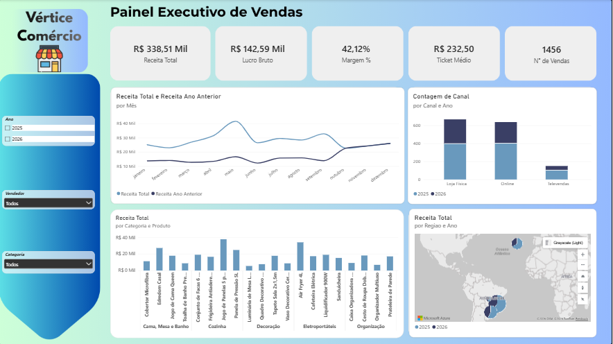

<div align="center">

# 📊 Painel Executivo de Vendas

### Dashboard em Power BI para análise comercial · Vértice Comércio


<br>



</div>

---

## 📌 Sobre o projeto

Dashboard de análise de vendas de uma loja fictícia, a **Vértice Comércio**, desenvolvido em **Power BI** para praticar o ciclo completo de BI: **ETL, modelagem de dados e criação de medidas em DAX**.

O painel reúne os principais indicadores comerciais em uma única tela, com filtros interativos para explorar os dados por ano, vendedor e categoria.

---

## 🎯 Objetivo

Acompanhar o desempenho comercial e responder perguntas como:

- 💰 Quanto estamos faturando e qual é a margem de lucro?
- 🏆 Quais produtos e categorias mais vendem?
- 👥 Qual o desempenho de cada vendedor e região?
- 📈 Como a receita evolui em relação ao mês e ao ano anteriores?
- 🛒 Qual canal de venda traz mais resultado?

---

## 🖼️ Visão geral do painel

| Elemento | Descrição |
|:---|:---|
| 🔢 **Cartões (KPIs)** | Receita Total, Lucro Bruto, Margem %, Ticket Médio e Nº de Vendas |
| 📈 **Gráfico de linhas** | Receita Total x Receita do Ano Anterior, mês a mês |
| 📊 **Gráfico de colunas** | Receita por Categoria e Produto |
| 📊 **Gráfico de colunas empilhadas** | Contagem de vendas por Canal e Ano |
| 🗺️ **Visual por região** | Receita Total por Região e Ano |
| 🎛️ **Segmentações** | Ano, Vendedor e Categoria |

### ✨ Indicadores em destaque

| Receita Total | Lucro Bruto | Margem | Ticket Médio | Nº de Vendas |
|:---:|:---:|:---:|:---:|:---:|
| **R$ 338,51 mil** | **R$ 142,59 mil** | **42,12%** | **R$ 232,50** | **1.456** |

---

## 🗂️ Modelo de dados

Modelo em **estrela (star schema)**, com a tabela fato **Vendas** ligada às dimensões:

```
        Produtos        Clientes
              \          /
               \        /
                 Vendas
               /        \
              /          \
      Vendedores       Calendário
```

---

## 🧮 Principais medidas DAX

| Categoria | Medidas |
|:---|:---|
| **Básicas** | `Receita Total` · `Custo Total` · `Lucro Bruto` · `Margem %` |
| **Clientes** | `Ticket Médio` · `Clientes Ativos` · `Receita por Cliente` · `Clientes novos` |
| **Inteligência de tempo** | `Var. Mensal %` · `Var. Anual %` |
| **Ranking** | `Ranking Produto` · `Ranking Vendedor` (RANKX) |
| **Participação** | `% do total` |

---

## 🛠️ Ferramentas utilizadas

- **Power BI Desktop** (formato PBIP)
- **Power Query** para tratamento e transformação dos dados (ETL)
- **DAX** para medidas e inteligência de tempo
- **Excel** como fonte de dados

---

## 🚀 Como abrir o projeto

1. Clone o repositório:
   ```bash
   git clone https://github.com/KaykyPramoshttps/V-rtice_Com-rcio.git
   ```
2. Abra o arquivo `.pbip` no **Power BI Desktop**.
3. Se necessário, ative o recurso **Projeto do Power BI (PBIP)** em *Arquivo → Opções → Recursos em versão prévia*.

---

## 👤 Autor

**Kayky Pereira Ramos**

[](https://github.com/KaykyPramoshttps)
[](https://www.linkedin.com/in/kayky-pereira-ramos-180770274)

<div align="center">

⭐ Se este projeto foi útil ou interessante, deixe uma estrela no repositório!

</div>
